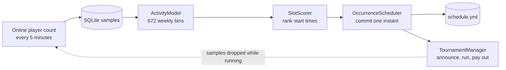

# wafflesonne-tournament

Automatic weekly tournament scheduling for wafflesonne.com, a Minecraft network
I have run since 2021 with 35,225 unique players. It is a Java 21 Paper plugin
that learns when players are online, commits to a time, and runs the event.

## The result that shaped it

Measured from 24,502 live samples over 16 weeks: **the top twelve time slots
differ by 0.42 players.** With about 14 observations per slot, that gap is noise.

The old plugin kept chasing those differences, so the announced time moved and
one bug skipped tournaments for three weeks. Averaging harder would only have
picked a different arbitrary winner, slowly. The redesign separates the estimate
from the promise: the estimate can change every night, while the announced time
cannot. The full analysis is in [docs/DESIGN.md](docs/DESIGN.md).

The sampler has since collected over 44,000 samples on the live server.

## How it works



## Run it

Requires Java 21 and Maven.

```bash
mvn test
mvn package
cp target/WaffleTournament-0.1.0.jar <server>/plugins/
```

The tests need no game server. They cover the estimator, scorer, time-of-week
arithmetic and payout curve. `src/main/resources/config.yml` documents every
setting.

## Design decisions

1. **Decay by elapsed time, not by sample count.** A bin is visited once a week.
   A count-based average would treat the first sample after a three-week outage
   as if it followed immediately. Decaying by real time lets old values fade
   during downtime.
2. **Commit to an instant, not a day and hour.** Selection writes an absolute
   timestamp to disk and nothing recomputes it. A restart cannot lose the
   schedule, and a restart during the scheduled minute runs the tournament late
   instead of skipping the week.
3. **Score a window, not a bin.** A start time is judged on the 30 minutes before
   and 90 minutes after it, so one 15-minute spike cannot capture the schedule.
   Samples taken during a tournament are dropped, so the event cannot teach the
   model that its own slot is busy.

## Limitations

- Unit tests cover the scheduling math only. The Paper integration, including
  `OccurrenceScheduler` and `TournamentManager`, is exercised on a test server
  and in production, not in CI.
- One server and one time zone, set in `ActivityStore`.
- Player-facing text is in Turkish.
- Depends on PlaceholderAPI and Vault when present, and falls back without them.

## More

[docs/platform.md](docs/platform.md) describes the network this runs on and what
went wrong along the way.
