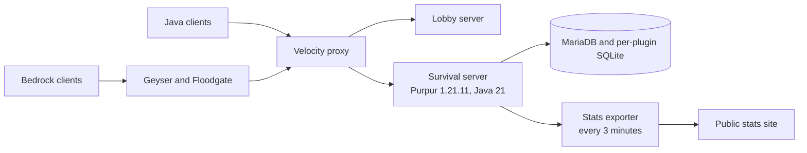

# The wafflesonne platform

wafflesonne.com is a Turkish-language Minecraft network I founded and have run since 2021.
35,225 unique players have joined, and its community has about
700 members on Discord. Everything below runs on one 2 OCPU, 12 GB ARM virtual
machine.

## Architecture

- **Proxy:** players connect to Velocity, which routes them to the lobby or the
  survival server. Java and Bedrock players share the same world.
- **Ordered startup:** a startup script brings the backends up and waits until
  they are healthy before the public proxy accepts anyone.
- **Stats site:** a Python exporter reads plugin data read-only and writes JSON
  for the site. Each section fails independently, so one bad data source leaves
  its previous output in place instead of breaking the page.

## Custom software

The server runs custom plugins alongside forks of open-source ones.

- Written from scratch: staff management, tournaments, dragon event contribution
  tracking, status reporting, data migration tools and smaller utilities.
- Forked: each fork keeps upstream's branch clean and puts local work on a
  `wafflesonne` branch, so a version bump starts from an exact diff of what we
  changed.

This repository is the first of those plugins to be published.

## Operations

- **Test server first:** updates go to a copy of the survival server refreshed
  by a maintenance script, then to production.
- **World maintenance:** a weekly job scans land claims and writes CSVs of chunks
  to keep. Pruning runs separately with the server stopped, because a running
  server holds region files open and pruning them live would corrupt the world.
- **Bounded logging:** scheduled jobs cap the block-logging database, because the
  history grows faster than the disk allows.

## Things that went wrong

### Tournaments silently stopped for three weeks

**What happened:** no tournament ran and nothing reported a failure. Nobody could
tell if it was broken or just unpopular.

**Cause:** a job re-picked the best slot just after midnight, and kept choosing
the evening that had just ended. That pushed the next tournament a full week out,
every night. The check that ran it also required the current hour to equal the
slot's hour, so a restart in that hour lost the week.

**Fix:** a persisted absolute start time, selection only inside a future window
anchored on the previous tournament, and a late start after a restart instead of
a skip. See [DESIGN.md](DESIGN.md).

**Lesson:** silent no-ops are the worst failure mode. The admin view now shows
each rejected slot and the rule that excluded it.

### Garbage packets flooding the log

**What happened:** the log filled with packet parsing errors reporting impossible
entity metadata types.

**Cause:** several anticheat plugins each shade their own relocated copy of a
packet library, which is the supported arrangement. A standalone copy at a
different commit had also been installed, putting a fifth reader in the same
network pipeline. Only one plugin referenced it, and only as an optional
dependency.

**Fix:** removed the standalone copy and recorded why, so the arrangement stays
understood.

**Lesson:** on a server with hundreds of plugins, the question is rarely which
plugin is broken. It is which two disagree.
